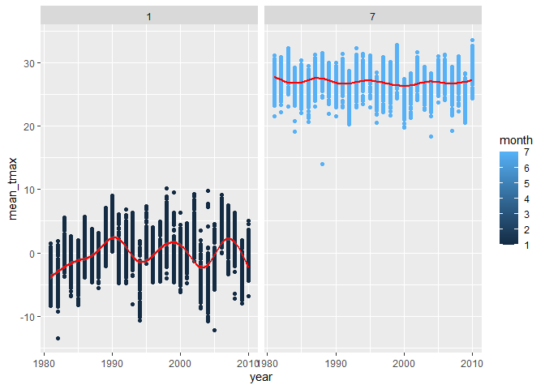
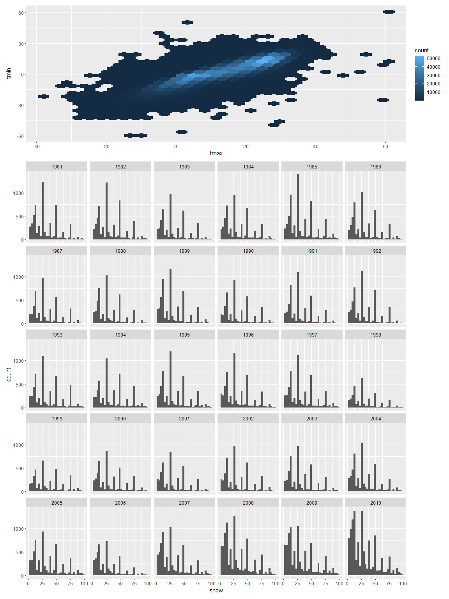
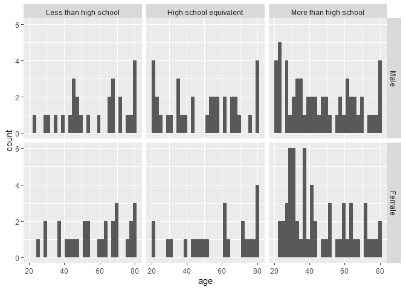
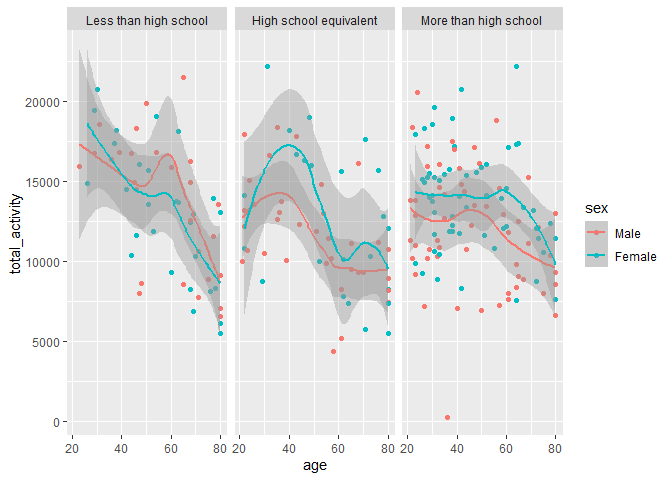
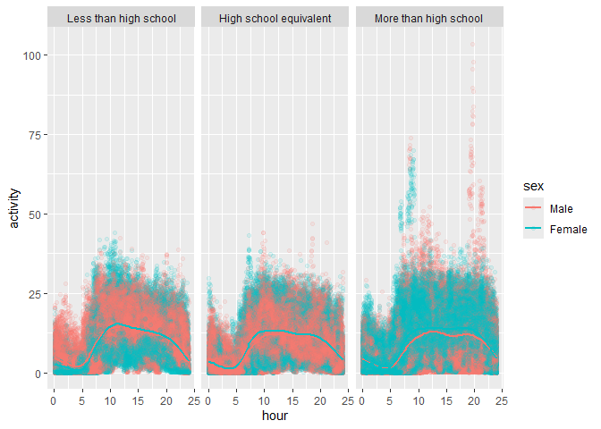

p8105_hw3_jem2315
================
Julian Morales
2026-10-13

## Problem 1

``` r
library(p8105.datasets)
data("ny_noaa")
#Data cleaning
ny_df = 
  ny_noaa |> 
  janitor::clean_names() |> 
  mutate(
    year = year(date),
    month = month(date),
    day = day(date),
    prcp = prcp/10,
    tmax = as.numeric(tmax)/10,
    tmin = as.numeric(tmin)/10
  )

#Most commonly observed snowfall values
ny_noaa |> 
  group_by(snow) |> 
  summarize(n_obs=n()) |> 
  arrange(desc(n_obs))
```

    ## # A tibble: 282 × 2
    ##     snow   n_obs
    ##    <int>   <int>
    ##  1     0 2008508
    ##  2    NA  381221
    ##  3    25   31022
    ##  4    13   23095
    ##  5    51   18274
    ##  6    76   10173
    ##  7     8    9962
    ##  8     5    9748
    ##  9    38    9197
    ## 10     3    8790
    ## # ℹ 272 more rows

``` r
#Average max temp in January and July in each station across years
ny_df |> 
  filter(month == 1 | month == 7) |> 
  group_by(id, year, month) |>
  summarize(
    mean_tmax = mean(tmax, na.rm = TRUE)) |> 
  ggplot(aes(x = year, y = mean_tmax, color = month))+
  geom_point()+
  geom_smooth(color = "red")+
  facet_grid(.~month)
```

<!-- -->

In the `ny_noaa` dataset, there are 7 columns/variables and a total of
2595176 observations tracking precipitation levels, snowfall, snow
depth, maximum and minimum temperatures, and the ID numbers of which
weather stations in New York state collected this data. In this dataset,
there are 3387623 total `NA` entries, meaning that 19% of the total
entries in the data set are `NA` values.

After cleaning the dataset, the most commonly observed values are 0 mm
with a count of 2,008,508 obs, NA with a count of 381,221 obs, and 25 mm
with a count of 31,022 obs. This is most likely due to the fact that New
York is a seasonal state with snowfall mostly occurring during the
winter season. Since snowfall is uncommon throughout most of the year,
there would not be many occurrences of snowfall in this dataset. The
large number of NA would also suggest that snowfall was not recorded for
every observation. When plotting the average max temperature for January
and July across years there seems to be fluctuating shape for the month
of January between low and medium temps, while July remains relatively
constant at higher temps. There are some outliers for both January and
July at lower temperatures.

``` r
#plot_i and plot_ii
library(patchwork)

plot_i = 
  ny_df |> 
  ggplot(aes(x = tmax, y = tmin))+
  geom_hex()

plot_ii = 
  ny_df |> 
  filter(snow > 0, snow < 100) |> 
  ggplot(aes(x = snow))+
  geom_histogram()+
  facet_wrap(.~year)

(plot_i/plot_ii)+
   plot_layout(heights = c(1, 3))
```

<!-- -->

## Problem 2

``` r
accel_df = 
  read_csv("data/nhanes_accel.csv", na = c("", ".", "NA")) |> 
  janitor::clean_names()

covar_df = 
  read_csv("data/nhanes_covar.csv", skip = 4, na = c("", ".", "NA")) |> 
  janitor::clean_names()

accel_covar = 
  left_join(accel_df, covar_df, by = "seqn") |>
  filter(age >= 21) |> 
  drop_na(sex, age, bmi, education) |> 
  mutate(
    sex = factor(sex,
                 levels = c(1,2),
                 labels = c("Male", "Female")),
    education = factor(education,
                       levels = c(1,2,3),
                       labels = c("Less than high school", "High school equivalent", 
                                  "More than high school"))
  )

#reader-friendly table
education_tb = 
  accel_covar |> 
  count(education, sex) |> 
  pivot_wider(
    names_from = sex,
    values_from = n
  )
knitr::kable(education_tb)
```

| education              | Male | Female |
|:-----------------------|-----:|-------:|
| Less than high school  |   27 |     28 |
| High school equivalent |   35 |     23 |
| More than high school  |   56 |     59 |

``` r
#age distribution visualization
accel_covar |> 
ggplot(aes(age)) + 
geom_histogram() + 
facet_grid(sex~education)
```

<!-- -->

In merging the two nhanes accelerometer and covariate data sets, it was
found that among the males in the data, 27 had a Less than high school
level education, 35 had a high school equivalent education, and 56 had
more than high school education. Among females in the dataset, 28 had a
Less than high school level education, 23 had a high school equivalent
education, and 59 had more than high school education.

In examining the age distribution across education levels, stratified by
sex, for both males and females, there seemed to be older participants
that had a Less than high school education (slightly skewed to the
left). For a high school equivalent education there is a wide spread of
ages with a heavier concentration of older participants among females
than males. For an education level that is more than high school there
is also a wide distribution of ages for both males and females, where
there are younger ages among females (slightly right skewed) compared to
males.

``` r
accel_covar |> 
  pivot_longer(
    min1:min1440, 
    names_to = "time",
    values_to = "activity"
  )|> 
  group_by(seqn, sex, education, age) |> 
  summarise(
    total_activity = sum(activity, na.rm = TRUE)
  ) |> 
  ggplot(aes(x = age, y = total_activity, color = sex))+
  geom_point()+
  geom_smooth()+
  facet_grid(.~education)
```

<!-- -->

In looking at total activity over the day between education categories
and sex, the general trend across all categories and sexes is that as
age increases, total activity decreases. Among those with a less than
high school education, males remain generally more active through most
ages as they get older compared to females, with a peak in activity
levels around 60 for both sexes and then a steep decline. Among those
with a high schoool equivalent education level, females remain
substantially more active than males, especially during the 20-50 age
range. Among those with more than a high school education, both male and
female activity stay consistent until the age 60 before declining.

``` r
accel_covar |>
  pivot_longer(
    min1:min1440,
    names_to = "time",
    names_prefix = "min",
    names_transform = list(time = as.numeric),
    values_to = "activity"
  ) |>
  mutate(
    hour = time/60
  ) |> 
  ggplot(aes(x = hour, y = activity, color = sex)) +
  geom_point(alpha = 0.1) +
  geom_smooth(se = FALSE) +
  facet_grid(. ~ education)
```

    ## `geom_smooth()` using method = 'gam' and formula = 'y ~ s(x, bs = "cs")'

<!-- -->

Over a 24-hour activity time course, across all education levels, there
is higher levels of activity occurring through the middle of the day
(between hours 10 - 15). Between all three education levels, those who
had more than high school education had substantially higher levels of
activity. Between the sexes, activity levels throughout the 24 hour
period coincide closely throughout the day.
